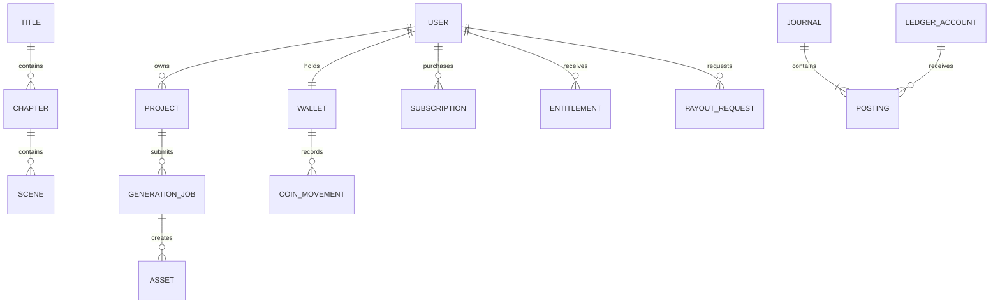

> Roadmap 4.0 · 30 October 2026 · Documentation baseline prepared under Instruction 001. Owner-dependent decisions remain pending; this document does not itself establish phase acceptance.

# Preliminary database design

Design only: SQLAlchemy models and Alembic migrations belong to Phase 3, with minimal identity schema introduced as needed for Phase 2. No schema is claimed deployed.

| Domain | Proposed entities and relationships |
| --- | --- |
| Identity | users, roles, permissions, user_roles, profiles, sessions, verification/recovery tokens; creator_profile belongs to user |
| Catalogue | titles (movie/series), seasons, chapters/episodes, scenes, genres/categories/languages, title classifications; explicit publication state and rights owner |
| AI | projects belong to creators; versioned stories, characters/world references, scene associations, generation_jobs, attempts, provider/model registry and usage/cost records |
| Media | assets with private storage keys, owner, provenance, checksum and rights; renditions, render/transcode jobs, subtitle/trailer/clip associations |
| Coins | wallet accounts, immutable coin movements, reservations, purchases and releases; purchased/promotional buckets |
| Access | plans, subscriptions, entitlements, unlocks and channel purchase references |
| Finance | payment_intents, provider_transactions, webhook_events, refunds, disputes, FX quotes, settlements, ledger_accounts, journals and postings |
| Creators | revenue allocations, earnings, holds/clearing, payout_requests, transfer_attempts, recipient verification and statements |
| Engagement | watch progress/history, watchlists, clips, share links, referral events, notifications/preferences and analytics events |
| Governance | moderation cases/actions, copyright records, approvals, audit events and retention/deletion records |

## Integrity requirements
- Stable opaque IDs, foreign keys, UTC timestamps and explicit status transitions; indexes on lookup/filter paths and owner/publication state.
- Unique channel/provider/external transaction identifiers and scoped idempotency keys; webhook deduplication before granting value.
- Coin units use integers; monetary values use exact numeric or currency-specific minor units with currency/exponent metadata. Never binary floats for money.
- Double-entry journals balance per currency; FX operations record both currencies and rates, never silently add unrelated currency amounts. USD reporting conversion retains source values and rounding policy.
- Wallet spend/reservation locks or conditional updates occur inside one transaction and cannot produce negative available funds. Immutable movements and compensating reversals preserve audit history.
- Creator earnings are separate from user coin wallets; pending, cleared and withheld funds determine payout availability. Unique payout references and transactional reservations prevent duplicate transfers.
- Premium unlock uniqueness prevents duplicate charges. Subscription renewals/revocations reconcile store and gateway state.
- Private asset ownership/provenance and content review status are mandatory before publishing.

## Migration and verification strategy
Version-controlled Alembic migrations, empty-database upgrade tests, upgrade of representative existing data, constraint/concurrency tests, backup before destructive changes and compatibility planning for staged releases. Retention, tax precision, business commission/attribution, payout clearing and deletion rules await owner decisions; do not encode invented values.
