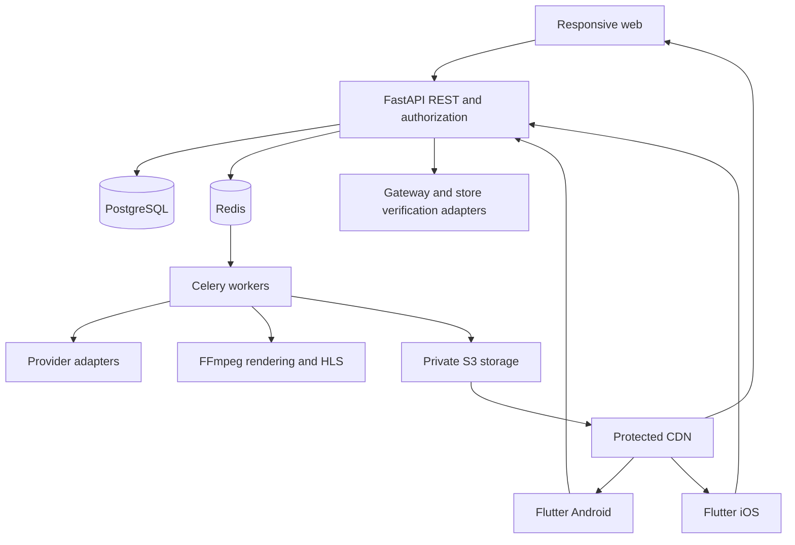

> Roadmap 4.0 · 30 October 2026 · Documentation baseline prepared under Instruction 001. Owner-dependent decisions remain pending; this document does not itself establish phase acceptance.

# System architecture

## Target design
A modular monolith serves REST/OpenAPI through FastAPI. Jinja2/Tailwind/JavaScript powers web MVP; a Flutter workspace shares Android/iOS code. PostgreSQL is authoritative business/financial storage. Redis provides queues/cache; Celery workers perform AI generation, media rendering/transcoding and later notifications. Private S3-compatible storage holds assets; a CDN delivers authorized HLS, not the API process itself.

## Boundaries and trust
Clients submit actions, never authoritative balances, earnings or entitlement decisions. APIs validate authentication/ownership and create durable job/transaction records. Financial changes commit atomically with unique external/idempotency references; introduce a transactional outbox when dispatch depends on committed database state. Workers consume only validated identifiers, expose states/errors and use scoped provider credentials. Private masters and drafts never use public object URLs. Payment callbacks require authenticity and replay protection. CDN access expires and renews only after entitlement validation.

## Modules and current foundation
`app/main.py` assembles application/lifespan and operational routes. `core/` owns settings/logging; `services/readiness.py` probes dependency availability; `workers/celery_app.py` is a JSON-only worker foundation. `api/`, `db/`, `models/` and `schemas/` are package boundaries ready for later implementation, not implemented business modules. No database schema, AI integration, media processing or financial operation exists yet.

## Environments
Development Compose: API, worker, PostgreSQL, Redis; optional local S3 emulation. Test: isolated unit tests plus opt-in real dependency probes and CI services. Staging/production: explicit validated configuration and secret injection; independent workers and private network services. No production environment is deployed by this task.

## Operations
`/health` retains original liveness behavior; `/live` is explicit process liveness. `/ready` requires database SELECT 1 and Redis PING within a bounded concurrent timeout; it does not promise worker capacity, schema migration readiness or storage availability yet. Request logs use generated IDs and sanitized JSON events. Metrics, traces, alerts, durable job state, backups and recovery rehearsals remain later work.

## Phase 2 Increment 1 implemented

app/db now owns the SQLAlchemy engine/session boundary; app/models/identity.py and additive Alembic revision 0001_identity_core persist users, extensible roles/permissions and registration audit events. app/api/auth.py exposes pending Viewer registration backed by app/services/registration.py. Passwords use pwdlib Argon2id; Redis provides an atomic bounded registration guard. Verification, login, sessions and administrative APIs remain later increments. No full authentication system is claimed yet.
